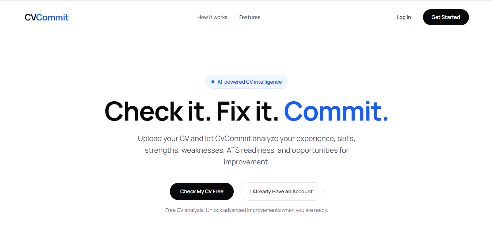
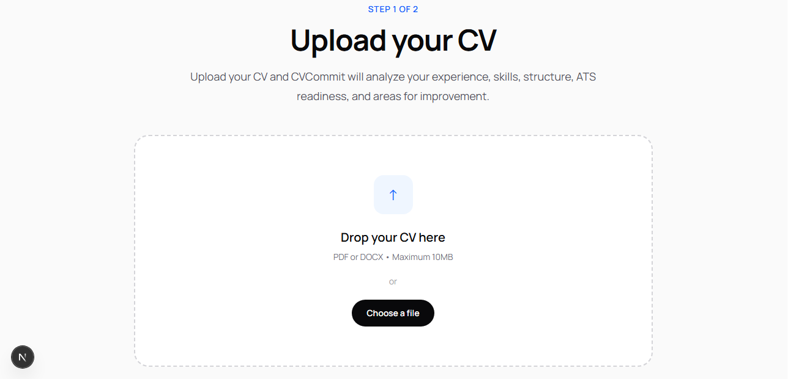
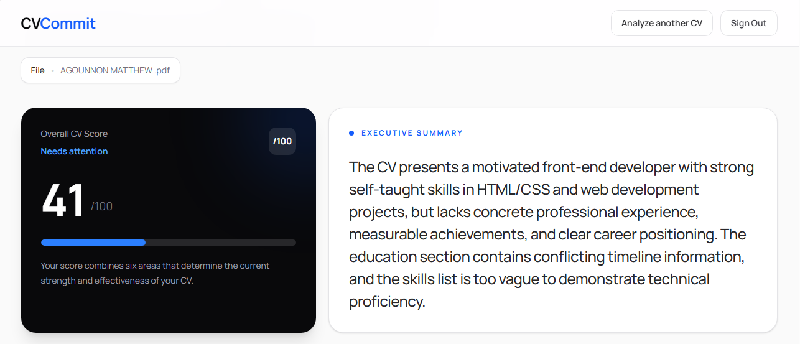
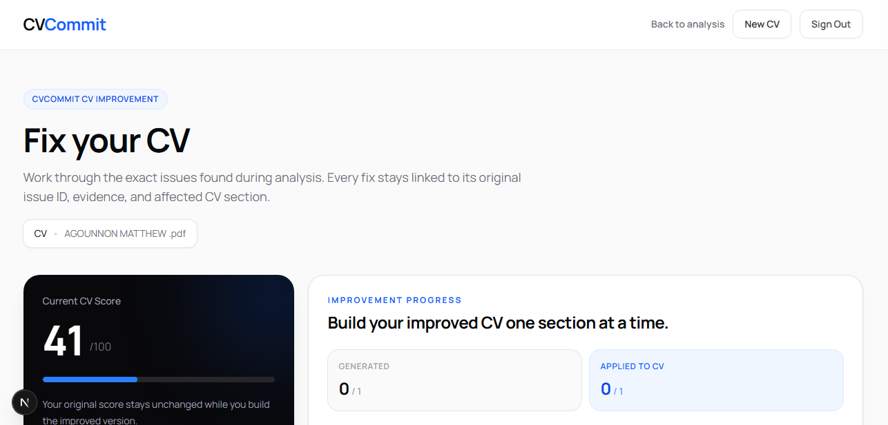

# CVCommit

### AI-Powered CV Analysis & Career Improvement Platform

CVCommit is a full-stack web application that analyzes a CV with AI, scores it, points out exactly what to fix, and helps the user turn it into an improved, downloadable CV.

A signed-in user uploads a CV (PDF or DOCX) and gets a free analysis with a score out of 100. Unlocking a CV adds **Fix My CV** (targeted AI rewrites), a **template preview**, and **PDF and DOCX export**.

**Live demo:** https://cvcommit.vercel.app

---

## Screenshots

| Landing page                                  | Upload                               |
| --------------------------------------------- | ------------------------------------ |
|  |  |

| Analysis results                             | Fix My CV                         |
| -------------------------------------------- | --------------------------------- |
|  |  |

---

## Key Features

- **Accounts** — Sign up, log in and reset a password with email and password through Supabase Auth.
- **CV Upload** — PDF or DOCX files up to 10 MB, with file type and size checks. Text is extracted on the server.
- **AI Analysis** — The CV is analyzed by Google Gemini. If Gemini is unavailable, OpenRouter is tried next, and a built-in rule-based analysis is the last fallback, so the user always gets a result.
- **Scoring** — An overall score out of 100 made of six parts: content and experience, skills relevance, professional positioning, ATS readiness, education, and CV structure. The score is added up on the server, so the AI cannot inflate it.
- **Traceable Issues** — Each issue points back to the CV text it comes from. The AI is told never to invent jobs, qualifications or skills.
- **Fix My CV** — Section-by-section AI rewrites that the user can apply or remove.
- **Template Preview** — Three CV templates: Classic, Modern and Compact.
- **Export** — Download the improved CV as **PDF** or **DOCX**. The export follows the template chosen in the preview.
- **Payments** — A one-time unlock per CV, paid through Paystack (₦7,500). Payments are checked on the server by both a verify step and a signed webhook. Each unlock has generous usage limits for AI fixes and downloads.
- **Responsive Design** — Works on desktop and mobile.

---

## How It Works

1. **Sign in** and open the upload page.
2. **Upload** a PDF or DOCX. The server validates the file and extracts its text.
3. **Analyze** — the server sends the text to the AI and returns a score, a breakdown, strengths, weaknesses and issues.
4. **Review** the results.
5. **Unlock** the CV with a Paystack payment to use the paid features.
6. **Fix** weak sections with AI-suggested rewrites.
7. **Preview** the CV in a template and **export** it as PDF or DOCX.

The CV text and analysis are kept in the browser's session storage while the user works. The server stores only the account, the plan, and a record of which CVs have been unlocked (a hash of the CV, not the CV itself).

---

## Tech Stack

| Area            | Tools                                                             |
| --------------- | ----------------------------------------------------------------- |
| Framework       | Next.js 16 (App Router), React 19, TypeScript                     |
| Styling         | Tailwind CSS 4                                                    |
| Auth & database | Supabase (`@supabase/ssr`, `@supabase/supabase-js`)               |
| AI              | Google Gemini (`@google/genai`), OpenRouter as a fallback         |
| Documents       | `unpdf` and `mammoth` (reading), `pdf-lib` and `docx` (exporting) |
| Payments        | Paystack                                                          |
| Hosting         | Vercel                                                            |

---

## Project Structure

```text
app/
  upload/  analysis/  results/  fix/  preview/  upgrade/     user-facing pages
  login/  signup/  reset-password/                           account pages
  api/
    upload/        text extraction
    analyze/       AI analysis
    fix/           AI rewrite of one section
    account/       current user, plan and unlock state
    payments/paystack/{initialize,verify,webhook}
    export/{pdf,docx}
components/cv/templates/   Classic, Modern and Compact previews
lib/
  supabase/   access/   payments/   cv/   analysis/
proxy.ts      redirects signed-out visitors away from protected pages
```

---

## Getting Started

### Prerequisites

- Node.js 20 or newer
- npm and Git
- A [Supabase](https://supabase.com) project
- A Gemini API key (recommended) and a Paystack account (for payments)

### Installation

```bash
git clone https://github.com/feyintioluwa/cvcommit.git
cd cvcommit
npm install
```

Create a `.env.local` file in the project root (see below), then start the app:

```bash
npm run dev
```

Open `http://localhost:3000`.

Other commands: `npm run build` (production build), `npm run start` (run the build), `npm run lint`.

---

## Environment Variables

Create `.env.local` in the root directory:

```env
# Supabase
NEXT_PUBLIC_SUPABASE_URL=your_supabase_project_url
NEXT_PUBLIC_SUPABASE_PUBLISHABLE_KEY=your_supabase_publishable_key
SUPABASE_SERVICE_ROLE_KEY=your_supabase_service_role_key

# AI
GEMINI_API_KEY=your_gemini_api_key
# GEMINI_MODEL=optional, overrides the default model
OPENROUTER_API_KEY=your_openrouter_api_key
# OPENROUTER_MODEL=optional, overrides the default model

# Payments
PAYSTACK_SECRET_KEY=your_paystack_secret_key
```

| Variable                                                           | Used for                                                       |
| ------------------------------------------------------------------ | -------------------------------------------------------------- |
| `NEXT_PUBLIC_SUPABASE_URL`, `NEXT_PUBLIC_SUPABASE_PUBLISHABLE_KEY` | Sign-in and reading the user's own data                        |
| `SUPABASE_SERVICE_ROLE_KEY`                                        | **Server only.** Records paid unlocks after a verified payment |
| `GEMINI_API_KEY`, `GEMINI_MODEL`                                   | Main AI provider                                               |
| `OPENROUTER_API_KEY`, `OPENROUTER_MODEL`                           | Fallback AI provider                                           |
| `PAYSTACK_SECRET_KEY`                                              | Starting payments and checking the webhook signature           |

### Notes

- Keep `.env.local` private and never commit it. `SUPABASE_SERVICE_ROLE_KEY` and `PAYSTACK_SECRET_KEY` must never be exposed to the browser.
- Without any AI key the app still works, using the built-in rule-based analysis.
- In your Paystack dashboard, set the webhook URL to `https://your-domain/api/payments/paystack/webhook`.

---

## Database

CVCommit uses two tables besides Supabase Auth:

- **`profiles`** — one row per user, with a `plan` column. A plan of `pro` gives account-wide access.
- **`cv_unlocks`** — one row per paid CV: the user, the CV hash, the payment reference, amount, currency, status and time. It is written only by the server with the service-role key, and its conflict key is `user_id, cv_hash`.

Both tables have Row Level Security enabled: users can only read their own rows, and only the server writes. Each paid unlock also keeps a count of Fix requests and downloads, with limits set in `lib/access/cv-quota.ts`.

The full setup (tables, security rules, the sign-up trigger and the usage-limit function) is in [`supabase/schema.sql`](supabase/schema.sql). Run it once in the Supabase SQL editor of a new project.

---

## Project Status

CVCommit is under active development. Current features: account sign-in, CV upload and processing, AI analysis and scoring, issue-by-issue fixes, three preview templates, PDF and DOCX export, and per-CV paid unlocking.

Planned work includes tightening how a payment is tied to a specific CV, and more templates.

---

## Links

- **Live Demo:** https://cvcommit.vercel.app
- **GitHub Repository:** https://github.com/feyintioluwa/cvcommit
